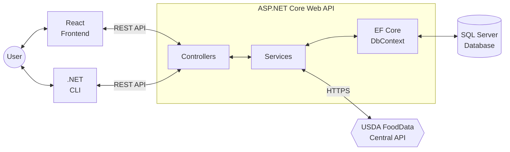
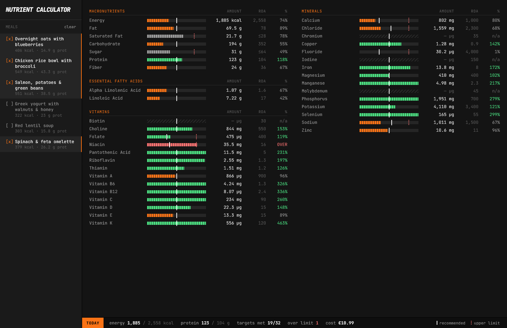

# Nutrient Calculator

## Overview

A full stack application for calculating the nutrients of meals. Selecting meals shows their combined macronutrients, vitamins and minerals. Each nutrient is compared against its Dietary Reference Intake (DRI), showing whether it falls short, meets the recommended amount or goes over the upper limit.

## Tech stack

- **Frontend:** React, Tailwind
- **Backend:** ASP.NET Core, Entity Framework Core, REST API
- **Database:** SQL Server
- **Other:** C#, Reqnroll, TypeScript

## Screenshots

| Main view                                        |
| ------------------------------------------------ |
|  |
